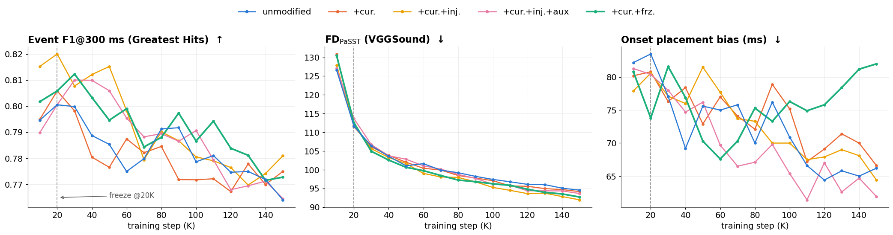

# Training Refines Onset Placement but Erodes Event Correspondence
### A Full-Trajectory Audit of Video-to-Audio Onset Alignment

**JoonHo Byun · Taegon Kim · Juyeon Park · Unsang Park**<br>
Sogang University · **WACV 2027**

Official evaluation code for our WACV 2027 paper. We study how event correspondence,
onset placement, and distributional audio quality evolve along video-to-audio training
trajectories, using Greatest Hits and an annotated 266-clip in-the-wild benchmark.

[Installation](#installation) · [Data](#data) · [Evaluation](#evaluation) · [Citation](#citation)

## Overview



Better onset placement and distributional audio quality can coexist with fewer detected
matches to reference events. Our evaluation separates these measurements across checkpoints
and examines training interventions. The figure summarizes the common 10K–150K grid;
inference-condition details are described in [the model guide](docs/models.md#inference-conditions).

## Release status

- [x] Evaluation and analysis code
- [x] Model architecture and weight-loading utilities
- [x] Benchmark annotations and companion data download
- [ ] Public paper link

**[Download the companion dataset on Hugging Face](https://huggingface.co/datasets/junhob/v2a-onset-audit)**

It includes annotations, curation records, evaluation tables, analysis features for 99
conditions, and representative generated audio for vanilla 10K/150K. Source videos,
original recordings, and model weights are not included.

## Installation

The evaluation environment was verified on **Linux, Python 3.11.11**, with pinned
dependencies in `requirements.txt`. The evaluation commands below run on CPU;
optional model utilities use [PyTorch 2.6.0](docs/models.md#install-optional-dependencies).

```bash
git clone https://github.com/cdcd09/v2a-onset-audit.git
cd v2a-onset-audit
python3.11 -m venv .venv
source .venv/bin/activate
python -m pip install -r requirements.txt
python -m pip install -e . --no-deps
python -m unittest discover -s tests -v
```

Run subsequent commands from the repository root. Model utilities have separate
[optional dependencies](docs/models.md#install-optional-dependencies).

## Data

Download the [companion dataset](https://huggingface.co/datasets/junhob/v2a-onset-audit),
then install metadata and choose the generated-audio shards needed for evaluation:

```bash
python scripts/setup_data.py --release-root /path/to/downloaded-release --data-root data
python scripts/setup_data.py --release-root /path/to/downloaded-release --data-root data \
  --list-audio-shards
```

See [data preparation](docs/evaluation.md#prepare-data) for shard selection and directory
layout. For original media, use the [Greatest Hits project](https://andrewowens.com/vis/).
For VGGSound, we provide **clip IDs/file stems, YouTube IDs, and start times**, plus our
onset annotations; see the [original repository](https://github.com/hche11/VGGSound).
We do not mirror either dataset's source videos or recorded soundtracks.

## Evaluation

After extracting the vanilla 10K audio shard:

```bash
export V2A_DATA_ROOT="$PWD/data"
python -m eval.onset_metrics \
  --gen_dir "$V2A_DATA_ROOT/generated/vanilla_10000/gh" \
  --split gh --out outputs/vanilla_10000_onset.json
```

The [evaluation guide](docs/evaluation.md) covers threshold sensitivity, annotation agreement,
event-triggered averaging, cross-correlation, and figures. The [model guide](docs/models.md)
covers weight checks, latent sampling, and the [reported training settings](docs/models.md#reported-training-settings).
Use the [paper-table index](docs/evaluation.md#paper-table-index) to locate each table's
released measurements and the corresponding supported evaluation commands.

This release supports evaluation and analysis. Full training and raw-video-to-waveform
inference have not been verified with this code snapshot.

## Repository layout

```text
v2a-onset-audit/
├── code/           # Scoring, analysis, figures, and model architecture
├── configs/        # Model settings and data setup manifest
├── docs/           # Usage guides, overview figure, and license notices
├── scripts/        # Data preparation
├── tests/          # Input-integrity and scoring regressions
├── pyproject.toml
└── requirements.txt
```

## Acknowledgments

The model code builds on [MMAudio](https://github.com/hkchengrex/MMAudio), and the onset detector
adapts [CondFoleyGen](https://github.com/XYPB/CondFoleyGen). We thank the authors of these projects
and the [Greatest Hits dataset](https://andrewowens.com/vis/).
Code is licensed under MIT; see [component licenses and attribution](docs/licenses/README.md).

## Citation

```bibtex
@inproceedings{byun2027training,
  title={Training Refines Onset Placement but Erodes Event Correspondence:
         A Full-Trajectory Audit of Video-to-Audio Onset Alignment},
  author={Byun, JoonHo and Kim, Taegon and Park, Juyeon and Park, Unsang},
  booktitle={Proceedings of the IEEE/CVF Winter Conference on Applications of Computer Vision},
  year={2027}
}
```
